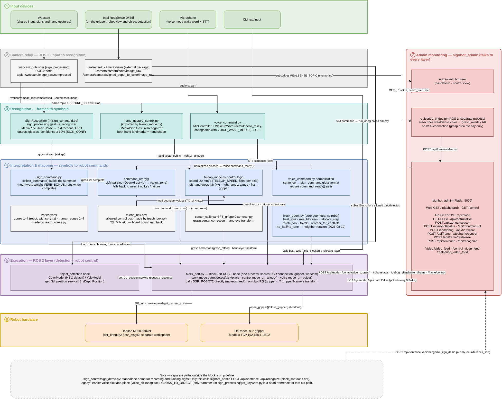
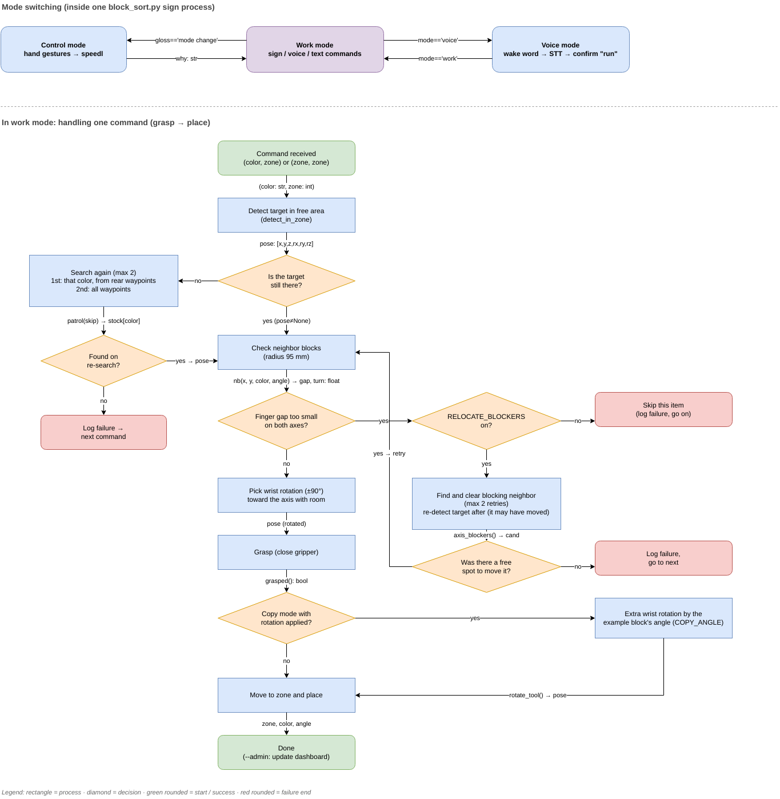

# Sign-Language-Controlled Robotic Arm

A Doosan M0609 arm with an OnRobot RG2 gripper sorts colored 35 mm blocks on a table, commanded by Korean Sign Language. The operator signs to a webcam (for example "red, zone 3", or just "copy" or "mirror"), a GRU classifier turns hand and body landmarks into words, and the robot finds, picks, and places the blocks. In copy mode it rebuilds a layout a person made, including each block's rotation. There is also a hand-gesture mode for moving the arm directly, and a voice mode.

ROKEY Robotics Bootcamp team project (5 people), August 2026. Built and tested on hardware.

> Korean version of this README: [README.ko.md](README.ko.md). The READMEs inside each folder are in Korean.

## Team

Yongjun Yu (team lead), **Gene Woo Lim**, Hyunjun Jeon, Taenam Kim, Seongwoo Park.

My part (Gene Woo Lim): sign recognition, body tracking, robot motion logic, grasp geometry, coordinate correction, system integration, and the TCP and hand-eye calibration.

## System overview

<p align="center"></p>

```
Sign → MediaPipe landmarks → GRU classifier → words → command parser → (color, zone)
     → color detection (RealSense) → grasp → place
```

| Folder | What it is |
|---|---|
| `sign_control/` | Record sign data and train the GRU classifier (`model.pt`) |
| `block_sort/` | Main program: command parsing, block detection, grasp planning, pick and place, copy/mirror, hand-gesture mode, voice mode |
| `sign_pickandplace/` | ROS 2 workspace: color-based block detection service (`/get_3d_position`), webcam publisher |
| `hand_gesture_control/` | Hand-gesture recognition used by the control mode |
| `signbot_admin/` | Flask dashboard (camera, recognized sentence, zones, robot status) |
| `calib/` | Shared calibration (`T_gripper2camera.npy`, hand-eye) |
| `legacy/` | Earlier voice-based pick-and-place |

<p align="center"></p>

## Sign recognition

- Features: 104 values per frame from MediaPipe hand and pose landmarks; 32-frame windows.
- Model: 2-layer bidirectional GRU (hidden 128), mean and max pooling, fully connected 512 → 128 → N. 542,469 parameters.
- Data: our own recordings, 20 samples per word. Augmentation: scale ±8%, noise σ = 0.012, time warp 0.8–1.25×.
- Vocabulary: 20 words (6 colors, 6 zones, 2 objects, 6 actions such as pick up, place, copy, mirror).
- Speed: about 30 fps end to end; classification takes 0.5 ms.
- In use, the confidence threshold is 0.60. Correct signs scored 80–91%, so 0.80 dropped many of them. Words are collected until they form a valid command, so a single wrong word does nothing.
- A language model (`gpt-4o`) turns the word list into (color, zone) pairs. If the API key is missing or the call fails, a rule-based parser is used.

## Main engineering problems

### 1. Calibration
Early grasps missed by a large amount because the calibration values were wrong. The TCP and hand-eye calibration were redone by hand, touching one point from many angles. Position error went from about 10 cm to about 1 cm.

### 2. Block center shifted when seen at an angle (optical-axis alignment)
From an angle, the side face of a block also shows up in the color mask, and the measured center moved by about 5 mm. The arm moves the camera straight above the block and measures again (several times, median). Detection on each reading also has to agree across frames.

### 3. Grasp offset that changes with the wrist angle
Grasps were off-center by 12 mm at 0° and 6.5 mm at 45°/135°. The error had a part fixed in the base frame and a part that turns with the wrist. Measuring at 0° and 90° separated them:

```
offset = A + R(θ)·B + built-in correction
A = (10.70, 19.70) mm  base frame
B = (−6.00, 6.00) mm   tool frame, θ = wrist angle
```

The wrist angle is decided first in `pick()`, so the tool part turns the right way.

### 4. Grasping next to other blocks
The RG2 fingers come down on both sides of one axis. A neighbor on that axis gets hit and the controller makes a protective stop. A square block is the same after a 90° turn, so the robot compares the gap on both axes and grips on the wider one.

| Value | Source |
|---|---|
| Finger tip thickness 25 mm, threshold 27 mm (`FINGER_GAP_MIN`) | measured |
| Needed center distance 35 + 27 = 62 mm | block + finger |
| Neighbor half-width at angle φ: 17.5·(\|cos φ\| + \|sin φ\|), up to 24.7 mm | geometry |

A grasp once judged a 34 mm gap as enough and hit a rotated neighbor. The detector gave each block's angle, but the neighbor check did not use it, and a rotated block is up to 7.2 mm wider per side. The angle is now passed into the check (`block_geom.nb_half`).

When both axes are blocked, the robot tries the cheapest option first:

| Order | Action | Default |
|---|---|---|
| 1 | Turn the wrist 90° (`best_axis`) | on |
| 2 | Change the pick order (`pick_order`, `choose_next`) | on |
| 3 | Move the blocking block straight to its own zone if it is in the plan | on |
| 4 | Slide the blocking block 60 mm while gripped (`slide_blocker`) | on |
| 5 | Lift it to a free spot (`relocate_one`) | off |

If none works, the robot stops and asks a person to clear the block. A block that already failed is not tried again (one run tried the same block 12 times in 129 s).

The geometry functions are tested without the robot:

```bash
python3 block_sort/test_avoid.py      # wrist 90° clearance (6 cases)
python3 block_sort/test_relocate.py   # blocker relocation targets (8 cases)
python3 block_sort/test_reorder.py    # copy-plan reordering (6 cases)
```

### 5. Zone radius from an error budget
| Item | mm |
|---|---|
| Half-diagonal of a 35 mm block | 24.7 |
| Placement error after calibration | about 10 |
| Detection error after alignment | about 10 |
| `ZONE_RADIUS` | 45 |

With zones 150 mm apart, this leaves a 62.5 mm lane between zones.

### 6. Reach limit found from logs
Across 185 logged attempts, only the x position separated failures: 78% aborted at x ≥ 630 mm, against 5% of attempts that converged. The limit was the camera: to look straight down at a far block, the arm must reach out by the hand-eye offset. Far blocks are deferred, not skipped (`REACH_X_MAX`).

### 7. Hand-gesture control mode
- Left hand moves X/Y, right hand moves Z, open palm / fist opens and closes the gripper.
- Velocity commands (`speedl`) at a constant 20 mm/s. Position targets ran ahead of the arm, the controller sped up to catch them, and the arm hit the board.
- Stops when the hand leaves the camera; only motion out of a taught box is blocked.
- Runs in the same process as the main program. A second robot connection made TCP readings drop to 0.0 mm and motions get rejected.

## Hardware

Doosan M0609, OnRobot RG2, Intel RealSense D435i (on the gripper), webcam for signs, 35 mm colored blocks.

## Software

Ubuntu 22.04, ROS 2 Humble, Python 3.10, MediaPipe, PyTorch, OpenCV, Flask. `numpy==1.26.4` and `mediapipe<1.0` are pinned; other versions conflict with `cv_bridge`.

## Usage

```bash
pip install -r requirements.txt

source /opt/ros/humble/setup.bash
source ~/ws_cobot_pjt/ws_dsr/install/setup.bash          # Doosan driver
source sign_pickandplace/install/setup.bash               # detection service

ros2 run object_detection object_detection                # color detector
python3 block_sort/teach_zones.py teach                   # teach zones (first time)
python3 block_sort/block_sort.py sign                     # run with sign commands
python3 block_sort/block_sort.py copy                     # copy a human layout
python3 block_sort/block_sort.py copy-mirror              # mirrored copy
python3 block_sort/sign_command.py selftest               # parser test, no hardware
```

`OPENAI_API_KEY` is optional (rule-based parsing is used without it). Do not commit `.env` files; this repository is public.
